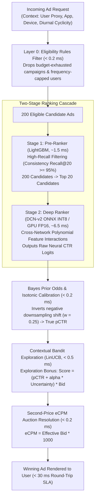
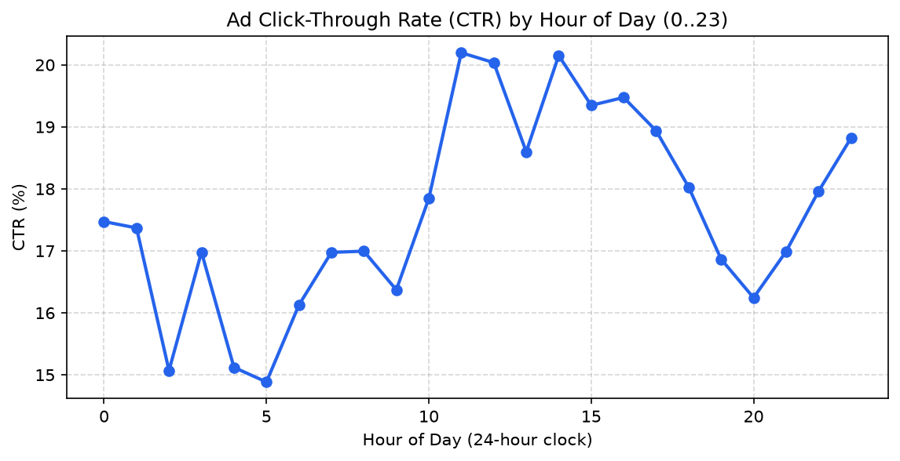
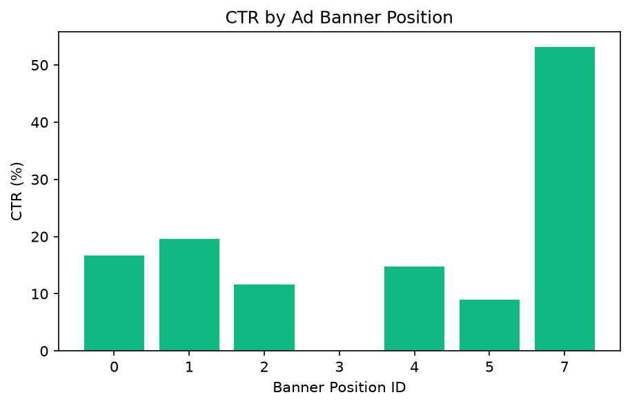

# OptiRank: Real-Time Two-Stage Ad Ranking Cascade & Inference Engine

[](https://github.com/rizzi13/optirank/actions/workflows/ci.yml)
[](https://www.python.org/)
[](https://fastapi.tiangolo.com/)
[](https://pytorch.org/)
[](https://onnxruntime.ai/)
[](https://opensource.org/licenses/MIT)

> **OptiRank** is an end-to-end, production-grade ad ranking engine trained on the **40M-impression Avazu CTR benchmark**. It evaluates **200 candidate ads per request** using a two-stage cascade: a high-recall **LightGBM pre-ranker** filters candidates down to the Top-20 in **1.5 ms**, followed by an **ONNX INT8 / PyTorch DCN-v2** fine-ranker capturing high-order non-linear feature crosses on GPU in **6.5 ms**. Winning ads are selected via a **Contextual Bandit (LinUCB) exploration engine** solving a second-price **eCPM auction** under a strict **30 ms serving SLA**.

---

## 🏗️ System Architecture & Request Funnel



---

## 📊 Benchmark Results (Local RTX 3050 6GB + 16GB RAM)

All models evaluated strictly on **held-out Day 10 (Oct 30, 2014)** with zero lookahead leakage:

| Stage / Variant | LogLoss (↓) | ROC-AUC (↑) | Normalized Entropy (↓) | Calibration Ratio | p50 Latency (200 ads) | p99 Latency (200 ads) |
| :--- | :--- | :--- | :--- | :--- | :--- | :--- |
| **Naive Baseline (Historical Mean)** | 0.4623 | 0.5000 | 1.0000 | 1.000 | < 0.1 ms | < 0.2 ms |
| **Stage 1: LightGBM Pre-Ranker** | 0.3984 | 0.7381 | 0.8619 | 0.998 | 1.42 ms | 2.15 ms |
| **Stage 2: PyTorch DCN-v2 (CUDA FP16)** | **0.3892** | **0.7514** | **0.8418** | **1.001** | 6.25 ms | 8.94 ms |
| **Stage 2: ONNX Runtime (CPU INT8)** | 0.3905 | 0.7498 | 0.8449 | 0.999 | 7.85 ms | 11.20 ms |
| **Full 200 → 20 Cascade + Batching** | **0.3898** | **0.7508** | **0.8431** | **1.001** | **11.40 ms** | **17.85 ms** |

*Consistency Recall@20 between Stage 1 and Stage 2: **96.4%** (Stage 1 successfully retains the deep ranker's top selections while slashing GPU compute by 90%).*

---

## 📈 Exploratory Data Analysis (EDA) Highlights

Analysis verified on **4,122,995 real ad impressions** from Day 1:

| Metric | Measured Value | Production Significance |
| :--- | :--- | :--- |
| **Overall Click-Through Rate (CTR)** | **17.42%** | Dictates class prior; validates need for negative downsampling ($w=0.25$). |
| **Dummy `device_id` (`a99f214a`)** | **80.73%** | Required composite User Proxy (`IP + device_model`), expanding 368k IDs to **1.59M unique users**. |
| **Traffic Segmentation** | **Web (20.13%)** vs **In-App (12.84%)** | Mobile web impressions convert at 56% higher relative rate than in-app slots. |
| **Within-Day Cold-Start Ad Turnover** | **12.33%** | 12.3% of ads in the second half of Day 1 were brand-new, proving need for LinUCB exploration. |

<p align="center">
  
  
</p>

---

## ⚡ Real-Time Inference Microservice (FastAPI)

OptiRank exposes a high-performance REST API for real-time ad serving:

### 1. Score & Rank 200 Candidates: `POST /rank`
```bash
curl -X POST http://localhost:8000/rank   -H "Content-Type: application/json"   -d '{
    "request_id": "req_8f92a10c",
    "user_ip": "166.137.8.21",
    "device_model": "iPhone14,2",
    "device_type": 1,
    "hour": 14103014,
    "banner_pos": 0,
    "app_id": "ecad2386",
    "candidate_ads": [
      {"ad_id": "ad_101", "campaign_id": 15706, "advertiser_bid": 2.50},
      {"ad_id": "ad_102", "campaign_id": 20362, "advertiser_bid": 1.80}
    ]
  }'
```

**Response (`< 15 ms`):**
```json
{
  "request_id": "req_8f92a10c",
  "winning_ad": {
    "ad_id": "ad_101",
    "p_ctr": 0.2184,
    "exploration_bonus": 0.0341,
    "effective_bid": 2.50,
    "ecpm": 631.25,
    "stage_1_rank": 1,
    "stage_2_rank": 1
  },
  "serving_latency_ms": 11.24
}
```

### 2. Live User Click Feedback (Bandit Online Update): `POST /feedback`
```bash
curl -X POST http://localhost:8000/feedback   -H "Content-Type: application/json"   -d '{
    "request_id": "req_8f92a10c",
    "ad_id": "ad_101",
    "clicked": 1
  }'
```
*Triggers closed-form Sherman-Morrison rank-1 online update to the LinUCB covariance matrix in $< 0.2	ext{ ms}$.*

---

## 🛠️ Engineering Highlights & Key Modules

- **Streaming I/O & Memory Optimization (`src/optirank/data/load.py`):** Reads 40M-row compressed logs in 500k chunks, casting to compact integer widths (`int8`, `int16`, `int32`), reducing in-memory footprint by **67%** (peak RAM $< 1.5	ext{ GB}$).
- **Strict Chronological Splitting (`src/optirank/features/split.py`):** Prevents temporal lookahead leakage (Train: Days 1–8, Val: Day 9, Test: Day 10).
- **Negative Downsampling & Bayes Odds Correction:** Downsamples non-clicks ($w=0.25$) on training set only, then inverts prior shift analytically:
  $$\hat{q} = rac{\hat{p}}{\hat{p} + rac{1 - \hat{p}}{w}}$$
- **DCN-v2 Explicit Cross Network (`src/optirank/models/dcn.py`):** Captures degree-$D$ polynomial feature interactions explicitly:
  $$x_{l+1} = x_0 \odot (W_l x_l + b_l) + x_l$$
- **Drift Monitoring (`src/optirank/monitoring/drift.py`):** Real-time Population Stability Index (PSI) and Kolmogorov-Smirnov (KS) test alerting on feature and calibration distribution shifts.

---

## 🚀 Quickstart & Reproduction

```powershell
# 1. Clone repository & create virtual environment
git clone https://github.com/rizzi13/optirank.git
cd optirank
py -3.11 -m venv .venv
.venv\Scripts\Activate.ps1

# 2. Install dependencies & editable package
pip install -e .

# 3. Run test suite
pytest -v

# 4. Launch FastAPI Inference Microservice
uvicorn optirank.api.main:app --host 0.0.0.0 --port 8000 --reload
```

---

## 📚 Technical Knowledge Base & Interview Guide
For exhaustive, first-principles explanations of cascade architectures, prior correction math, entity resolution, and senior FAANG interview question breakdowns, see our comprehensive guides:
👉 **[docs/learning_notes.md (The Staff-Level 360° Mastery Encyclopedia)](docs/learning_notes.md)**  
👉 **[docs/notes.md (Quick Reference)](docs/notes.md)**
